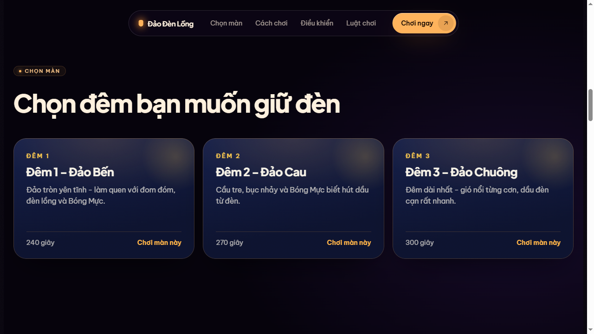
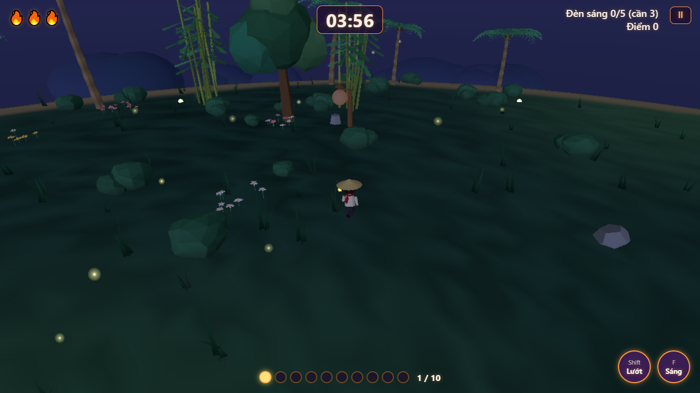
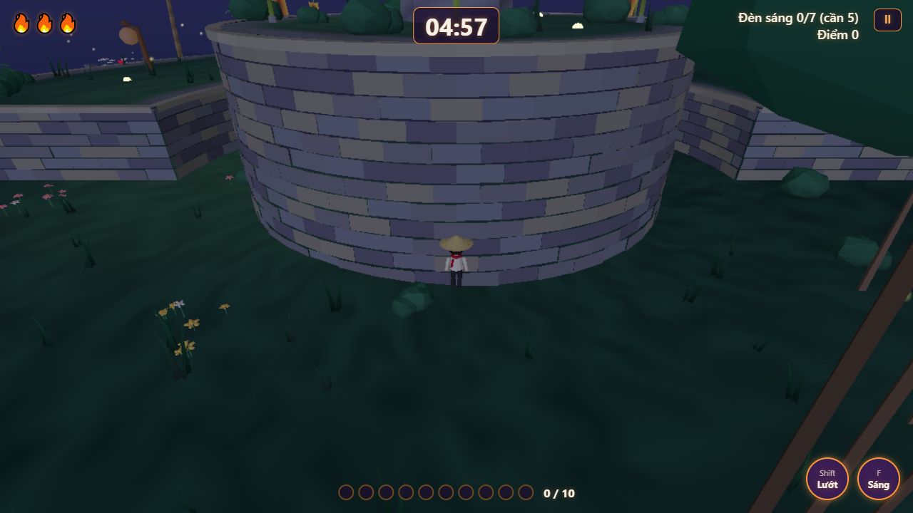
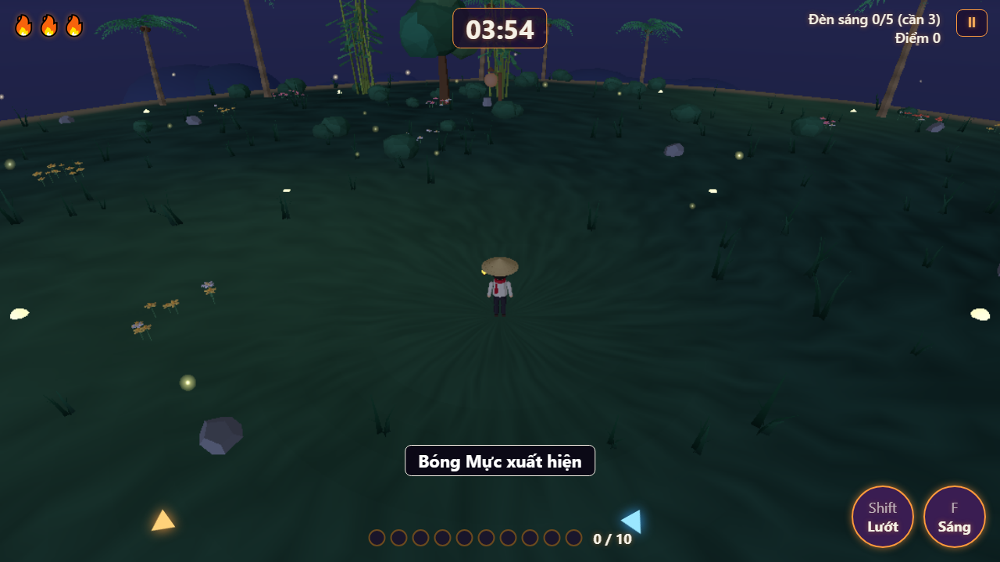
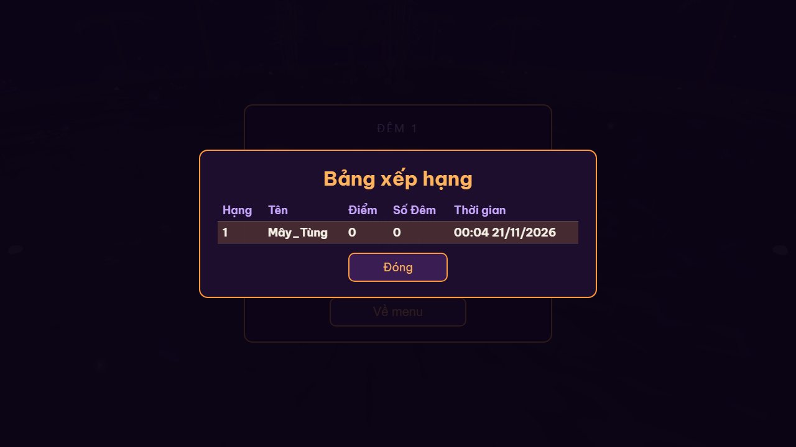
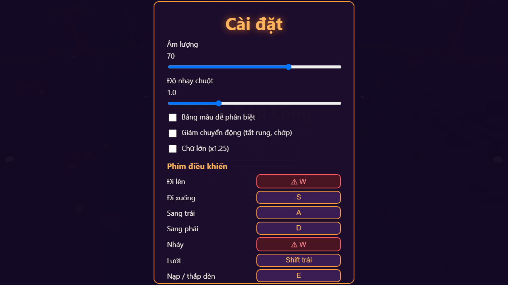

# Đảo Đèn Lồng - v1.0.0 (Bình minh)

Game 3D (Three.js + TypeScript): nhặt đom đóm, nạp vào Đèn Lồng Lớn, tránh Bóng Mực và Gió Lạc, giữ đủ đèn sáng (tiếp dầu khi cạn) cho tới bình minh, qua 3 Đêm. Có bảng xếp hạng top 10, đổi phím, chế độ trợ năng, bench và soak test.
Lõi mô phỏng (`src/core`) là TypeScript thuần, chạy 60 tick/giây, dùng chung cho bản web và chế độ headless (Test Contract v1.3, tất định theo seed).

Sinh viên: Nguyễn Hoa Thanh Tùng - 2A202603519. Tag nộp bài: `phase-1`, `phase-2`, `phase-3`, `phase-4` (kèm GitHub Release `v1.0.0`). Các tài liệu đề lab nằm trong [`lab/`](lab/).

| | |
|---|---|
|  |  |
|  |  |
|  |  |

## Video demo

[Xem video demo trên Google Drive](https://drive.google.com/file/d/1GY-fwOsiljrYQ28tCmeRnOz_59X2aXrQ/view?usp=drive_link) (4 phút 18 giây, 1280x720, có tiếng).

- 0:00-3:08: chơi thử trên web.
- 3:08-4:18: bằng chứng chạy lệnh: `npm test` (178/178 pass), headless seed 42, bench 30 giây trên Chrome, soak 10 Đêm (0 crash).

Ghi chú: số bench hiện trong video (avg 73.5 FPS, p1 low 13.8) thấp hơn `bench.json` (100.7 / 33.1) vì lúc quay ffmpeg ghi màn hình chiếm CPU cùng lúc; `bench.json` là lần đo không quay.

## Yêu cầu hệ thống

- Node >= 20 (đã chạy với Node 24), npm. Không cần biên dịch native; binary prebuilt cho linux/darwin/win32 đã có trong `package-lock.json`.
- Trình duyệt hiện đại có WebGL2 (Chrome/Edge/Firefox mới), màn hình tối thiểu 1280x720, bàn phím và chuột. Bản đo FPS dùng Chrome trên Windows 10.
- Chạy bench cần Playwright (đã có trong devDependencies) và Chrome cài sẵn (có thể dùng Chromium của Playwright: `npx playwright install chromium`).
- GPU rời không bắt buộc: có chế độ CPU (xem cuối README). Máy đo của repo là GPU rất yếu (GT 730).

## Cài đặt và chạy (3 lệnh)

```
npm ci
npm run build
npm start
```

Mở http://localhost:4173 (đổi cổng bằng biến môi trường `PORT`). `npm start` chạy `node server.mjs`: phục vụ `dist/` và API bảng xếp hạng (`/api/leaderboard`), dữ liệu lưu ở `data/leaderboard.json` (tự tạo, không commit). Chế độ dev: `npm run dev`.

Trang đầu là landing page có hướng dẫn chơi và chọn Đêm. Game 3D chỉ được tải sau khi bấm **Bắt đầu chơi**. Thêm `?play=1` vào URL để bỏ qua landing.

## Điều khiển

| Phím (mặc định) | Tác dụng |
|---|---|
| W A S D | Di chuyển (theo hướng camera) |
| Space | Nhảy |
| Shift trái | Lướt (dash): 12 tick ở 14 m/s, hồi chiêu 1.5 s |
| E | Nạp đom đóm vào đèn gần nhất trong 2m: đèn tắt thì thắp (hoặc thắp lại), đèn sáng thì châm dầu |
| F | Tỏa sáng (pulse): choáng và đẩy Bóng Mực trong 5m, tốn 3 đom đóm |
| Kéo chuột / phím mũi tên trái-phải | Xoay camera (yaw đưa vào `cam_yaw_deg`) |
| P | Tạm dừng / tiếp tục (lõi dừng hoàn toàn); menu có Tiếp tục, Chơi lại Đêm, Cài đặt, Về menu |
| Esc | Luôn tạm dừng / tiếp tục (không đổi được) |
| R | Chơi lại (ở màn kết thúc) |

**Đổi phím:** Cài đặt > Phím điều khiển cho 9 hành động (đi 4 hướng, nhảy, lướt, nạp/thắp đèn, tỏa sáng, tạm dừng). Trùng phím thì hiện cảnh báo và không áp dụng; nút "Khôi phục mặc định" đặt lại. Esc, mũi tên trái/phải và R là phím cố định. Lưu ở `localStorage` (`dao-den-long.settings.v1`).

**Trợ năng:** phụ đề (chữ) và mũi tên ở mép màn hình chỉ hướng Bóng Mực mới xuất hiện; cảnh báo gió sắp thổi, 10 giây cuối, đèn dầu thấp; giảm chuyển động (tắt rung camera và chớp màn hình); chữ UI tối thiểu 18 px ở 1280x720, tùy chọn chữ lớn x1.25; chế độ dễ phân biệt màu (từ Phase 3). Cài đặt khác: âm lượng tổng 0-100, độ nhạy chuột 0.2-3.0.

**Bảng xếp hạng:** sau khi thắng bình minh hoặc thua, nhập tên (có kiểm tra hợp lệ) để vào top 10. Xem top 10 từ landing, màn chọn Đêm và menu trong game. Chọn Đêm có ở landing và trong Cài đặt.

## Kiểm thử

```
npm test            # vitest, 178 test
npx tsc --noEmit    # kiểm kiểu
```

`npm run build` đã gồm `tsc --noEmit`, `vite build` và bundle headless, soak, server bằng esbuild.

## Headless

```
node dist-headless/headless.mjs --seed 42 --night 1 --ticks 1200 --out out/run.jsonl \
  [--scenario scenario.json] [--inputs inputs.json] [--snapshot-every 10]
```

- `--night` nhận 1, 2 hoặc 3 (mặc định 1); giá trị khác, hoặc thiếu `--seed`/`--ticks`/`--out`: mã thoát 1. File scenario/inputs sai định dạng: mã thoát 2.
- Output JSONL: snapshot tick 0, ngay sau đó event `night_start`, rồi `event` và `snapshot` (mỗi `--snapshot-every` tick; khi tạm dừng snapshot ghi `state: "paused"`), dòng `end` luôn cuối. Cùng seed + cùng đầu vào cho output giống hệt từng byte.
- Input thêm `dash`, `pause`. Scenario thêm `player.{invuln_ticks, dash_cd_ticks, pulse_cd_ticks, charm_ticks, successful_lights}`, `lanterns[].{lit, fuel, ever_lit}`, `shades[].{state, state_ticks_left, target_lantern_id}`, `drifters`, `charms`, `random_drifters`, `wind_enabled`.
- Snapshot v1.2+: đèn có `fuel` (1 chữ số), `ever_lit`, `relit_count`; player có `capacity`; Bóng Mực có state `drain`.
- Ví dụ scenario/inputs: `evidence/phase-3/scenarios/`, `evidence/phase-2/scenarios/` và `evidence/phase-1/scenarios/`.

## Bench (đo FPS)

```
node scripts/bench.mjs --seed 42 --duration 30 --out bench.json
```

Cần `npm run build` trước. Script dùng server đang chạy ở `PORT` (mặc định 4173) hoặc tự khởi `server.mjs`, mở Chrome có giao diện (Playwright, headed) cỡ 1280x720 với `--disable-gpu-vsync --disable-frame-rate-limit`, vào `/?bench=<seed>&duration=<s>`. Cảnh bench cố định theo seed (cờ `bench` của lõi tắt sinh thực thể, va chạm, hao dầu và kết thúc ván; cờ này mặc định false, không có trong snapshot, không rút RNG nên không đổi output headless). Bỏ 3 giây khởi động rồi đo `duration` giây.

Kết quả đã commit ở `bench.json` (máy dev: Windows 10, NVIDIA GeForce GT 730, Chrome, three.js r170 WebGL2):

| Trường | Giá trị |
|---|---|
| avg_fps | 100.7 |
| p1_low_fps | 33.1 |
| frame_ms_p95 | 18 |
| frames | 3020 |
| load_ms | 3736 |
| peak_mem_mb | 515 |
| vsync_off | true |

Ghi chú:
- **vsync:** tắt được bằng cờ Chrome nên `vsync_off: true`. Trên máy chỉ có một GPU yếu, tắt vsync làm CPU đẩy lệnh nhanh hơn GPU vẽ; để số FPS phản ánh GPU thật, game dùng một rào (fence) nhịp khung hình theo GPU (`src/web/gpu-frame-pacing-fence.ts`). Nhờ đó `avg_fps` không bị thổi phồng bởi các khung chưa được GPU vẽ xong.
- **peak_mem_mb:** tổng RSS của cả cây tiến trình bench (Node + Chrome + các tiến trình con GPU/renderer), lấy mẫu mỗi 3 giây trong lúc đo. Là bộ nhớ vật lý của tiến trình, không phải heap JS và không gồm VRAM của GPU.
- **p1_low_fps** là FPS ở nhóm 1% khung hình chậm nhất (33.1 trên GT 730, còn trên ngưỡng 30). Số đo phụ thuộc máy; số trong repo là của máy dev nói trên, không phải máy chấm.
- Tối ưu vẽ trong Phase 4: shade và đom đóm dùng `InstancedMesh` (khoảng 800 xuống khoảng 100 draw call), vật liệu Lambert cho phần mờ đục, fence nhịp GPU.

## Soak test

```
node dist-headless/soak.mjs --seed 7 --nights 10 --out soak.json
```

Chạy 10 Đêm liên tiếp bằng input ngẫu nhiên tất định (theo seed), đo bộ nhớ đầu và cuối. Kết quả ở `soak.json`: `crashes` 0, bộ nhớ 51 MB đến 57 MB. Dùng được `--seed`, `--nights`, `--out`.

## Xuất bảng xếp hạng

```
node server.mjs --export-leaderboard out.json
```

Ghi `{"entries":[...]}` theo thứ tự bảng (từ `data/leaderboard.json`) rồi thoát 0. Cũng chạy được `npm start --export-leaderboard out.json`.

## Bản phát hành

`npm run release` (sau `npm run build`) tạo `release/dao-den-long-v1.0.0.zip` gồm `dist/`, `dist-headless/`, `server.mjs`, `scripts/`, `package.json`, `package-lock.json`, `game.contract.json`, README, LICENSE, CREDITS. Giải nén rồi `npm start` (hoặc `node server.mjs`) là chơi được, không cần `npm ci` vì server chỉ dùng Node built-in và `three`, `gsap` đã nằm trong `dist/`; chỉ cần Node >= 20. Chạy bench từ bản zip thì cần thêm `npm ci` (Playwright). File zip đính kèm GitHub Release `v1.0.0`.

## Ba Đêm

| Đêm | Đảo | Thời gian | Đèn | Bóng Mực (cách nhau / tối đa) | Khác |
|---|---|---|---|---|---|
| 1 | Đảo Bến: đĩa bán kính 40 | 240 s | 5 | 480 tick / 6 | không Gió Lạc, không bùa |
| 2 | Đảo Cầu: hai đĩa bán kính 28 (tâm x=0 và x=70) nối bằng cầu tre | 270 s | 6 | 420 tick / 8 | 2 bục nhảy, Bùa Gió C1 (35,0,0), Gió Lạc |
| 3 | Đảo Chuông: 3 tầng (0 / 3 / 6 m), 2 dốc, tháp chuông | 300 s | 7 | 360 tick / 10, tốc độ 4.5 | bục nhảy tầng 1, 2 Bùa Gió, Gió Lạc, gió mạnh |

Mọi Đêm: không còn tường ở mép đảo, rơi xuống dưới y = -10 là mất 1 Ngọn Lửa và toàn bộ đom đóm đang mang, chờ 60 tick rồi hồi sinh ở điểm xuất phát với 90 tick bất tử.

## Số chuẩn

Nguồn duy nhất cho tuning: `game.contract.json` (v1.3, tuning giữ nguyên từ v1.2). Các số chuẩn khác của đề nằm trong `src/core/constants.ts` và `src/core/nights/`.

| Khóa | Giá trị | Khóa | Giá trị |
|---|---|---|---|
| player_speed | 6 (7.2 khi có bùa) | flames | 3 |
| carry_capacity | 10 | invuln_s | 1.5 |
| lantern_cost | 10 | hit_drop_ratio | 0.5 |
| pickup_radius | 1 | pulse_stun_s / pulse_push_m | 2 / 4 |
| interact_radius | 2 | pulse_cooldown_s | 3 |
| pulse_cost / pulse_radius | 3 / 5 | safe_radius | 6 |
| shade_speed | 4 (Đêm 3: 4.5) | shade_hit_radius | 1 |
| night1/2/3_duration_s | 240 / 270 / 300 | fall_enabled | true |
| fuel_max / fuel_decay_per_s | 100 / 1.0 | fuel_per_mote | 10 |
| relight_cost | 5 | win_ratio | 0.6 |
| drain_per_s | 5 | low_fuel_threshold | 30 |
| capacity_max | 20 | | |
| dash_speed / dash_duration_s / dash_cooldown_s | 14 / 0.2 / 1.5 | | |

## Luật chơi tóm tắt

- Đom đóm: 20 con lúc đầu, cứ 240 tick sinh thêm 1 nếu tổng < 30; đom đóm rơi sống 480 tick. Sức chứa = min(20, 10 + 2 x số lần thắp thành công). Đèn chưa sáng cần 10 đom đóm (nhớ tiến độ); đèn từng sáng rồi tắt chỉ cần 5 để thắp lại.
- Dầu đèn: đèn sáng có dầu 0-100, giảm 1/giây; mỗi đom đóm châm thêm 10 (tối đa 100, event `refuel`). Dầu về 0 thì đèn tắt (`lantern_out`). Đèn dầu < 30 nhấp nháy và không còn vùng an toàn.
- Bóng Mực: 2 con tại tick 300, sau đó theo chu kỳ của Đêm. Trạng thái `spawning` (60 tick) -> `wander` -> `chase` (trong 12 m, bỏ đuổi ngoài 18 m); chạm: mất 1 Ngọn Lửa, đánh rơi một nửa đom đóm, bất tử 1.5 s. Đèn sáng với dầu >= 30 có vùng an toàn bán kính 6. Bóng Mực đang đi lang thang sẽ tới đèn dầu < 30, đứng cách <= 2 m và hút thêm 5 dầu/giây (state `drain`, event `fuel_drain` mỗi 1 s); tỏa sáng trúng Bóng Mực đang hút được 15 điểm. Hết choáng Bóng Mực luôn về `wander`.
- Gió Lạc (Đêm 2, 3): từ tick 1200, tối đa 2 con; cướp tối đa 3 đom đóm khi bạn mang >= 5. Tỏa sáng khi nó đang đuổi thì nó bỏ chạy tay không; khi đang chạy với đồ cướp thì thả lại toàn bộ.
- Bùa Gió: 600 tick chạy 7.2 m/s và lướt không hồi chiêu; xuất hiện lại sau 2700 tick.
- Gió mạnh (Đêm 3): mỗi 1800 tick, báo trước 120 tick, thổi 300 tick, đẩy 2 m/s theo hướng ngẫu nhiên.
- Thắng: tới bình minh (`time_left_s <= 0`) còn Ngọn Lửa và >= ceil(0.6 x tổng) đèn sáng (event `game_over` `dawn_survived`). Thua: hết Ngọn Lửa (`no_flames`, luôn xét trước) hoặc tới bình minh mà không đủ đèn sáng (`dawn`). Thắp đủ đèn không kết thúc ván.

## Cách tính điểm

| Sự kiện | Điểm |
|---|---|
| Nạp 1 đom đóm vào đèn (thắp hoặc châm dầu) | 5 |
| Thắp sáng 1 đèn lần đầu | 100 |
| Thắp lại 1 đèn đã tắt | 40 |
| Choáng 1 Bóng Mực bằng pulse | 5 |
| Choáng 1 Bóng Mực đang hút dầu | 15 |
| Mỗi đèn còn sáng ở bình minh (chỉ khi thắng) | 50 + dầu còn lại (phần nguyên) |
| Mỗi Ngọn Lửa còn lại (chỉ khi thắng) | 50 |

Tổng điểm game trên web là tổng điểm các Đêm đã thắng.

## Giả định (chỗ đề còn mở, ghi là [TQ] trong spec)

Chi tiết đầy đủ: `docs/superpowers/specs/2026-11-20-dao-den-long-phase2-design.md`.

- **Di chuyển:** tăng tốc/dừng tức thì (thỏa "<= 0.1 s", giữ đúng 0.1 m/tick của Phase 1); `facing` là hướng của lần di chuyển khác 0 gần nhất, đầu Đêm là +Z.
- **Địa hình:** leo/xuống chênh <= 0.3 m mỗi tick; chênh lớn hơn là vách, chặn theo từng trục (trượt dọc vách). Nhảy khi đang lướt bị bỏ qua.
- **Lướt:** trên không giữ nguyên độ cao (vy = 0) trong lúc lướt; hồi chiêu tính từ tick bắt đầu; không bất tử.
- **Bục nhảy:** đứng trong 1 m quanh tâm bục là bị bắn; sau lướt `launchVel` tiếp tục, vy bắt đầu lại từ 0. Đêm 2: vy 14, 24 m/s về tâm đảo kia; Đêm 3: vy 12, 8 m/s theo -Z. Đêm 3 bục ở (0,3,13) (tầng 1), bắn Mây lên tầng 2.
- **Gió mạnh:** báo trước từ `simTick = 1800k - 120`, thổi trong `[1800k, 1800k + 300)` với k >= 1; hướng rút từ RNG lúc bắt đầu báo trước (số nguyên 0-359).
- **Điểm xuất phát Đêm 3 = (0,0,-20)** (đề không nêu): (0,0,0) nằm trong đĩa tầng 2 và tháp. Quyết định ở sổ SDD.
- **Đom đóm:** điểm trống = không có đom đóm nào trong 1.0 m (XZ); hết điểm trống thì bỏ lượt sinh. Nhặt cần chênh cao <= 1.5 m. Scenario `random_motes: false` tắt luôn lịch sinh mỗi 240 tick (giống `random_shades: false`) nên scenario có `motes` tường minh giữ đúng tập đó.
- **Đèn:** nạp cần chênh cao <= 1.5 m. Bóng Mực lọt vào vùng an toàn lúc đèn vừa sáng bị gắn cờ `evicting`: đi ra mép trong <= 30 tick, không gây sát thương, trạng thái hiển thị giữ nguyên.
- **Pulse:** tâm = chân + 0.8 m; tâm Bóng Mực = mặt đất + 1.0; đo 3D. Y của Bóng Mực trong scenario được gắn lại vào mặt đất + 1.0.
- **Bóng Mực:** `spawning` đứng yên, không gây hit, không bị đẩy; `wander` đi 0.5 x tốc độ, đổi hướng mỗi 120 tick; hết `recoil` thì về `chase` nếu <= 18 m, ngược lại `wander`; hết `stunned` luôn về `wander` (Phase 3). Đi theo cùng luật bước với Mây, không đi ra mép tầng cao (coi như vách), nên không lên tầng 2. Scenario thiếu `state` thì Bóng Mực ở `chase`. Điểm sinh hợp lệ: cách Mây >= 15 m và ngoài vùng an toàn đèn đã sáng.
- **Hit:** điểm rơi đom đóm ở vành 1.5-2.5 m quanh Mây; không có đất ở điểm rơi thì đặt tại XZ của Mây.
- **Gió Lạc:** điểm sương = `shadeSpawnPoints` của Đêm; bay ở Y = 1.5, không bị địa hình hay vùng an toàn chặn; tỏa sáng trúng Gió Lạc đang `idle` thì không đổi; `removed` vẫn nằm trong mảng với `state: "removed"`. Điểm thả: dưới Gió Lạc, không có đất thì XZ của Mây.
- **Tạm dừng:** cạnh nút khác phát sinh lúc tạm dừng bị bỏ; snapshot vẫn ghi theo `tick`.
- **Snapshot:** `invuln` là boolean; `night_start` ghi một lần ở tick 0, ngay sau snapshot đầu (dòng đầu file vẫn là snapshot).
- **Thưởng bình minh** chỉ khi thắng (công thức ở mục tính điểm); hết Ngọn Lửa luôn thua và được xét trước. Mọi kết thúc xét ở bước 11 (không kết thúc giữa tick).
- **Dầu và đèn (Phase 3):** dầu là số nguyên đơn vị 1/60 để ngưỡng 30 và 0 không lệch tick; thứ tự tick: bước 2 giảm bộ đếm rồi đốt/hút dầu và tắt đèn cạn; xem `docs/adr/0001-lantern-fuel-state-and-dawn-win.md`. Điểm Phase 3 (5/40/15...) là quyết định của người viết.
- **Seed web** = `Date.now()` ở tầng web; lõi vẫn tất định.
- **Kiểm thử:** `npm test` xanh ở cuối Phase 4 (178 test). Phase 3 không thêm test mới theo quyết định của chủ dự án; test cũ bị luật mới làm sai được sửa hoặc xóa, ghi ở `CHANGELOG.md`. Phase 4 đổi một kỳ vọng phá vỡ: `tests/smoke.test.ts` đọc contract 1.3 (trước đó 1.2).
- **Bench/soak (Phase 4):** cờ `bench` của lõi mặc định false, không nằm trong snapshot, không rút RNG; soak dùng input ngẫu nhiên tất định theo seed. Bảng xếp hạng lưu ở tệp JSON của server (không có cơ sở dữ liệu), một server một tệp.

## Acceptance criteria cho 8 mục của Phần 3

1. **Gió Lạc:** tối đa 2 con, sinh ở tick 1200/2400/... (Đêm 2, 3), id D1, D2; `idle` -> `chase` khi mang >= 5 và <= 15 m; chạm <= 1.2 m cướp min(3, đang mang) và phát `drifter_steal`, rồi `flee` 240 tick; tỏa sáng khi `chase` thì `flee` không cướp, khi `flee` có đồ thì `drifter_drop` và biến mất sau 120 tick; không mất Ngọn Lửa; vùng an toàn không chặn; bất tử không ngăn bị cướp. Bằng chứng: `evidence/phase-2/drifter-steal-pulse-n2.jsonl`.
2. **Bùa Gió:** C1 (35,0,0) ở Đêm 2, C1/C2 ở Đêm 3; nhặt theo luật đom đóm phát `charm_picked {charm_ticks: 600}`; chạy 7.2 m/s, lướt không hồi chiêu; xuất hiện lại sau 2700 tick. Bằng chứng: `charm-n2.jsonl`.
3. **Chuỗi 3 Đêm:** menu -> giới thiệu Đêm -> chơi -> kết quả -> Đêm kế; thua thì chơi lại Đêm đó; thắng Đêm 3 hiện màn Bình Minh với tổng điểm. Bằng chứng: headless `--night 1|2|3` (`default-night*-seed42-run*.jsonl`) và ảnh web (do task web ghi bổ sung).
4. **Tạm dừng (Esc/P):** lõi dừng hoàn toàn (không giảm bộ đếm, không nhặt), snapshot `state: "paused"`, event `paused`/`resumed`; menu có Tiếp tục / Chơi lại Đêm / Cài đặt / Về menu. Bằng chứng: `pause.jsonl`.
5. **Cài đặt:** âm lượng và độ nhạy chuột lưu qua các lần mở game (`localStorage`, try/catch, lỗi thì dùng mặc định). Kiểm trên web.
6. **Âm thanh:** nhạc nền và SFX tổng hợp bằng WebAudio cho nhặt, thắp đèn, tỏa sáng, bị đánh, nhảy, lướt, thắng, thua, Bóng Mực xuất hiện, đếm ngược 10 s cuối, cảnh báo gió; lấy từ event của lõi. Kiểm trên web.
7. **HUD đầy đủ:** Ngọn Lửa, `mm:ss` (đỏ và nhấp nháy khi <= 30 s), đèn k/n và điểm, thanh đom đóm 10 ô, hồi chiêu Lướt và Tỏa Sáng, nhắc "E - Nạp ánh sáng (x/10)", mũi tên tới đèn chưa sáng, chỉ báo bùa và cảnh báo gió. Kiểm trên web.
8. **Bảng màu chuẩn:** hex của đề cho trời, sương, cỏ, cát, gỗ, biển mây, đèn, đom đóm, Bóng Mực, áo/khăn Mây, bùa, viền vàng, Gió Lạc, UI (sai lệch <= 10% mỗi kênh); ánh sáng môi trường `0.15 + 0.55 x (đèn sáng / tổng đèn)`. Kiểm trên web.

Mục 5-8 và FPS (>= 30 ở 1280x720) thuộc bản web, được kiểm riêng; kết quả ghi ở `evidence/phase-2/` khi có.

## Sáng tạo của tôi

- Landing page có hướng dẫn chơi (cách chơi, điều khiển, tính điểm, luật), game chỉ tải sau khi bấm Bắt đầu (từ Phase 1).
- Phase 1: Mây đội nón lá treo đèn lồng, Bóng Mực khối tím, đảo sáng dần khi thắp đèn (low-poly dựng từ khối cơ bản).
- Phase 4: tối ưu vẽ (instancing, Lambert, fence nhịp GPU) đưa bench trên GT 730 lên 100 FPS; bảng xếp hạng top 10 với server Node thuần; đổi phím 9 hành động, phụ đề và mũi tên chỉ Bóng Mực mới, chữ lớn, giảm chuyển động; script đóng gói `npm run release`; retro ở [`docs/retro.md`](docs/retro.md).
- Phase 3: Đèn có thanh dầu trên đỉnh, nhấp nháy khi sắp cạn; Bóng Mực tới hút dầu đèn yếu; bảng màu dễ phân biệt (`#7A3CFF` sang `#00B3FF`); evidence và ADR cho mô hình dầu.
- Phase 2: bộ scenario headless riêng cho từng tính năng và script sinh bằng chứng (`scripts/generate-evidence-phase-2.mjs`), skill dự án `dao-den-long-contract` để agent giữ đúng luật contract khi mở rộng.
- Đồ họa đảo mới trong game (`src/web/decor/`): mỗi Đêm có địa hình stylized khớp đúng mặt đi của gameplay (cỏ, bãi cát, vách đá treo, bậc tầng, cầu tre), bầu trời trăng sao, biển mây, sương, đom đóm và đạo cụ riêng (làng chài Đêm 1, đảo cau Đêm 2, gác chuông Đêm 3). Ánh sáng vẫn theo công thức 0.15 + 0.55 x đèn sáng/tổng. Mây là nhân vật có khớp: tay chân vung theo tốc độ thật của người chơi (lướt nhanh hơn, đứng yên thì thở nhẹ), đèn trên nón và khăn lắc theo quán tính. Không bloom trong game để giữ FPS (khoảng 35-38 FPS ở 1280x720 trên máy dev). Ảnh: `evidence/decor-demo/game-night1.png`, `game-night2.png`, `game-night3.png`.
- Chỉ đổi phần hiển thị: output headless giữ nguyên, `diff` JSONL `--seed 1 --ticks 3600` trước/sau tích hợp trùng khớp cả 3 Đêm (`.superpowers/sdd/2026-11-20-island-decor-demo/integration-baseline/` và `integration-after/`).

## Bằng chứng

- Phase 4: [`evidence/phase-4/`](evidence/phase-4/README.md) (ảnh chụp trợ năng và bảng xếp hạng), `bench.json`, `soak.json` ở gốc repo. Retro: [`docs/retro.md`](docs/retro.md); lịch sử thay đổi: [`CHANGELOG.md`](CHANGELOG.md); ghi công: [`CREDITS.md`](CREDITS.md).
- Phase 3: [`evidence/phase-3/`](evidence/phase-3/): JSONL cho cạn dầu (`fuel-out`), châm dầu (`refuel`), thắp lại (`relight`), Bóng Mực hút dầu (`drain`), thắng và thua ở bình minh (`win-dawn`, `lose-dawn`); `determinism.txt`, `headless-timing.txt`, `vitest.txt` (chạy thật). Sinh lại: `npm run build && node scripts/generate-evidence-phase-3.mjs`. Quyết định thiết kế: [`docs/adr/0001-lantern-fuel-state-and-dawn-win.md`](docs/adr/0001-lantern-fuel-state-and-dawn-win.md); thay đổi phá vỡ: [`CHANGELOG.md`](CHANGELOG.md).
- Phase 2: [`evidence/phase-2/`](evidence/phase-2/) (JSONL sinh bởi contract v1.1, xem ghi chú trong thư mục): JSONL cho dash, bục nhảy Đêm 2 và 3, rơi và hồi sinh, gió, Gió Lạc cướp/thả, bùa, tạm dừng, trạng thái Bóng Mực, vùng an toàn, thắng đúng tick bình minh; `determinism.txt` (cả 3 Đêm); `headless-timing.txt` (21600 tick mỗi Đêm). Sinh lại: `npm run build && node scripts/generate-evidence-phase-2.mjs`. `vitest.txt` chỉ ghi lý do không chạy lại test.
- Phase 1: [`evidence/phase-1/README.md`](evidence/phase-1/README.md) và `node scripts/generate-evidence.mjs`.
- Nhật ký dùng AI và giả định: [`docs/ai-log.md`](docs/ai-log.md); quy trình AI: [`AGENTS.md`](AGENTS.md), [`docs/ai-process/phase-1/`](docs/ai-process/phase-1/).

## Chạy chỉ bằng CPU (khi GPU bị lỗi hiển thị)

```
npm start
npm run play:cpu
```

Cách thủ công: mở Chrome với `--use-angle=swiftshader --enable-unsafe-swiftshader --disable-gpu-rasterization`, rồi vào http://localhost:4173/?cpu=1. Chế độ `?cpu=1` hạ chất lượng (không khử răng cưa, độ phân giải thấp hơn, không PointLight) để chạy mượt bằng CPU. Đặt `CHROME_PATH` nếu script không tìm thấy trình duyệt.

## macOS / Linux

Toàn bộ là Node thuần (>= 20) và Vite; không cần biên dịch native vì lockfile chứa binary prebuilt cho linux/darwin, đường dẫn dùng `node:path`. Mới chỉ kiểm trên Windows qua Git Bash, từ bản sao sạch: `npm ci && npm run build && node dist-headless/headless.mjs ...` (xem `docs/ai-log.md`). Chưa chạy trên macOS/Linux thật.

Dev: `?play=1&night=2` (hoặc `night=3`) vào thẳng màn giới thiệu của Đêm đó; `scripts/measure-fps-and-screenshots.mjs` đo FPS và chụp ảnh bằng Playwright (`evidence/phase-2/`).
